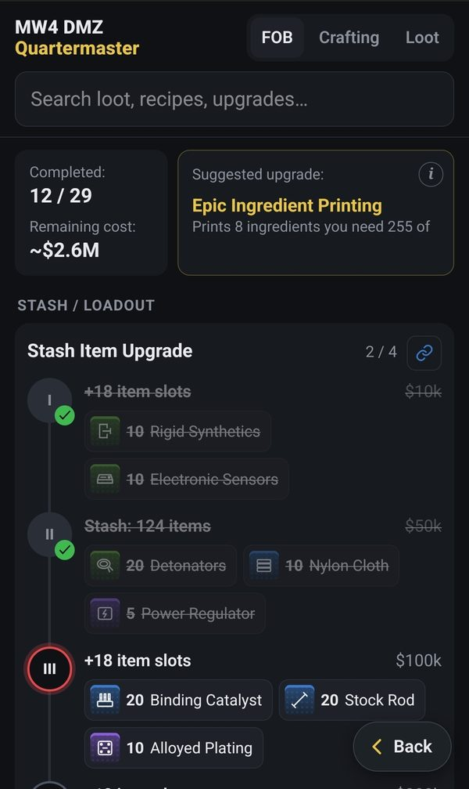
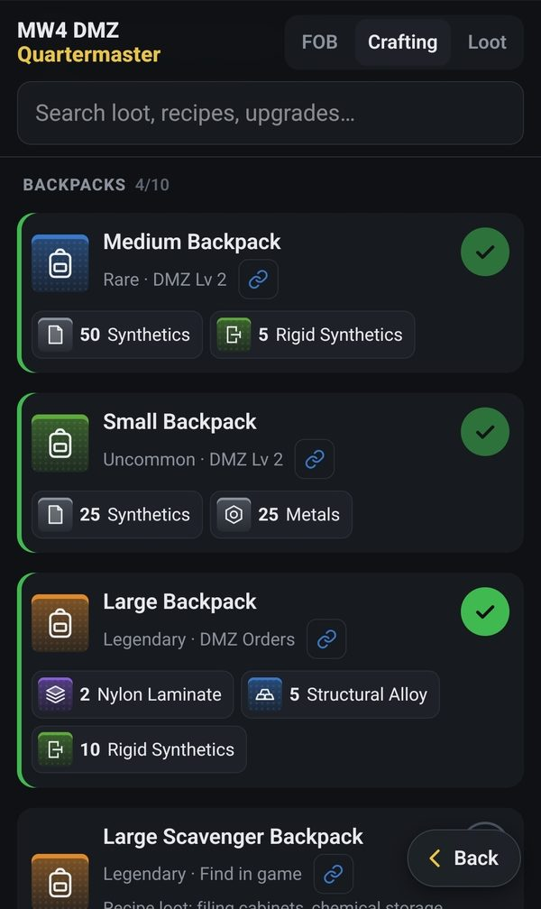
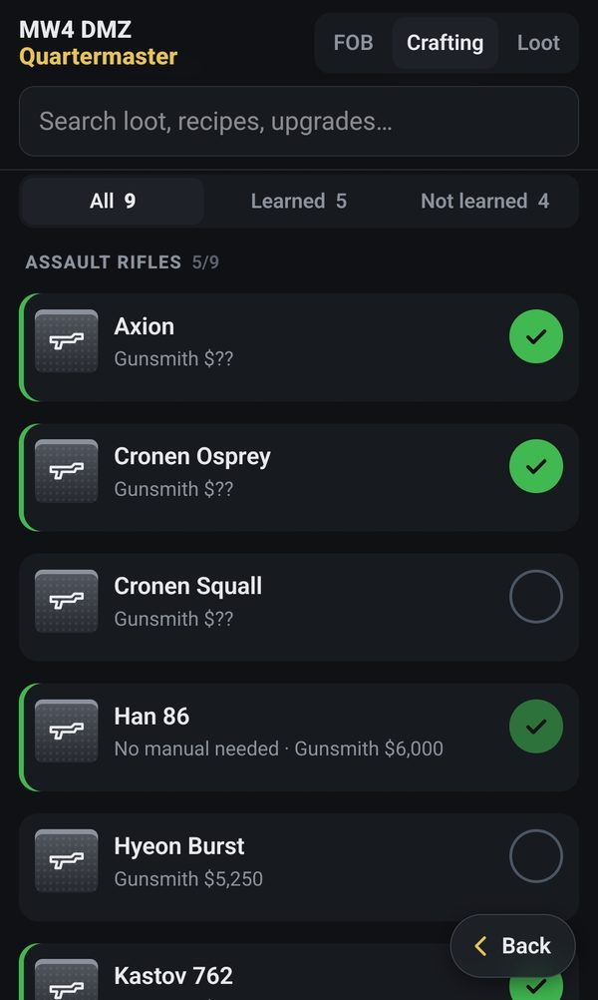
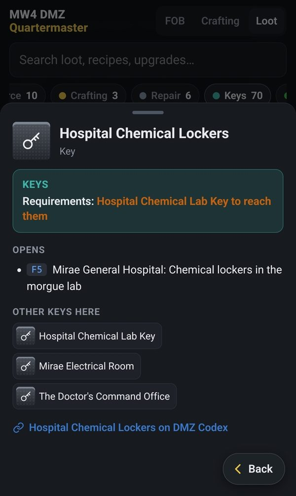

# Games

Games-related bits 'n bobs.

## MW4 DMZ Quartermaster

**`mw4-dmz-quartermaster.html`** - MW4 DMZ stash and FOB advisor - **built for phones**, use in the field and the most efficient use of precious bag space. Check your stash and unlocks in-game, get info on most loot items, exfil with only what you needm give away or safely sell what you don't. 

[**Open it here**](https://triffski.github.io/tr_scripts/games/mw4-dmz-quartermaster.html)

No install/dependencies - open the link or download  the `.html` to your phone. Progress is saved to the browser. 

  
  

  
  

- **FOB:** upgrade checklist:
  - See what you've unlocked, prioritise what's left and where to gather the materials you need.
  - Get suggested next upgrades, based on your progress.
- **Loot:** every ingredient, valuable, repair part and key:
  - Know exactly what to exfil with and what you can safely donate/sell/leave behind.
  - Where to find most items (with grid refs/threat ratings) and what they're used in.
  - Check if a key you're planning to use requires other keys or items.
- **Crafting:** 3D Printer recipe and Gunsmith weapon manual checklists:
  - Check whether to exfil a manual/recipe/item or if you can safely give it to a teammate.
- **Search:** instantly search most loot, recipes, manuals and upgrades.

Export/Import to back up or move between devices. Level-based rewards are checked automatically based your FOB upgrades, enter the rest as you get them (quite satisfying...). 

Data is community-sourced (DMZ Codex, CODCentral, Activision...), some costs/locations are unconfirmed.
